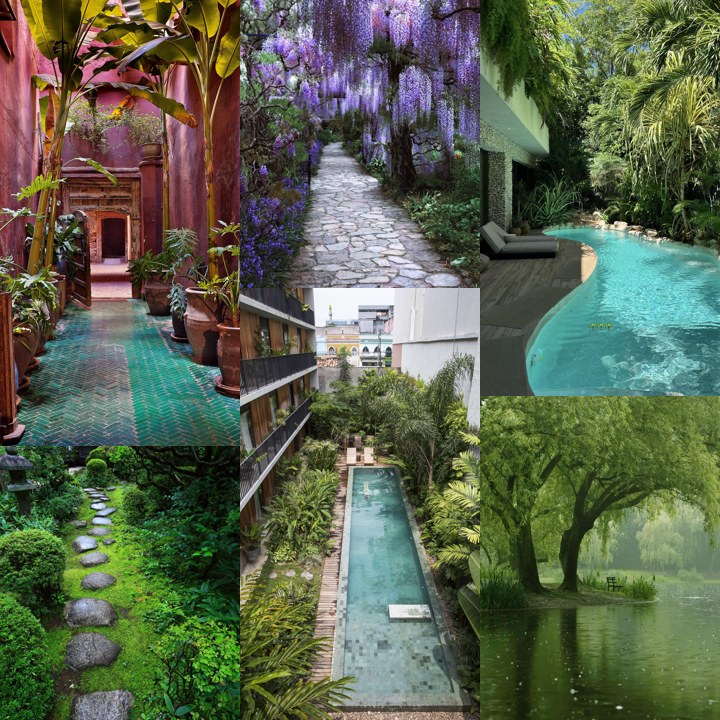
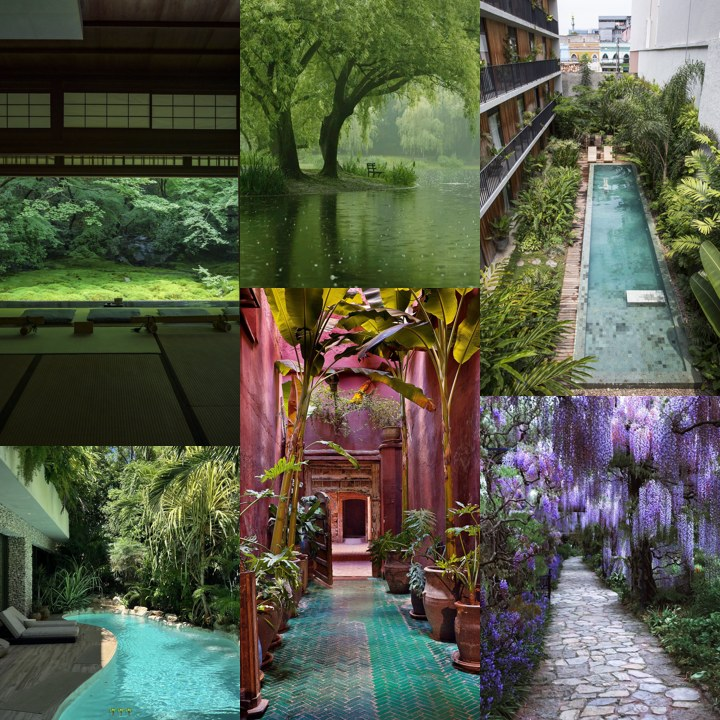
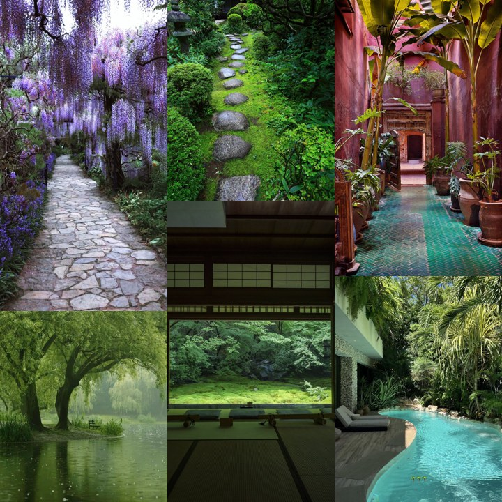

# Moodglass

*By Astra.* Turn your favorite Discord photo chats into a dreamy background behind all of Discord.

## The Background

Pick a chat full of photos, and Moodglass lays them edge to edge behind Discord, like a window you can see through.

| Another mix | And another |
| --- | --- |
|  |  |

**[⬇ Download Moodglass](https://github.com/findastra/moodglass/releases/latest/download/moodglass-20261024.plugin.js)**

**Needs:** the Discord desktop app with [BetterDiscord](https://betterdiscord.app/).

## Install

1. Install [BetterDiscord](https://betterdiscord.app/).
2. Download **moodglass-20261024.plugin.js** with the button above. Don't double-click it. It only works inside Discord.
3. In Discord, open **Settings → BetterDiscord → Plugins → Open Plugins Folder**, and drag the file in.
4. Turn on **Moodglass** in that same Plugins list.
5. Click **✎** at the top right, then **+**, then click a chat with photos. That's it!

### Buttons & Instructions

| Button | What it does |
| --- | --- |
| **A chat's button** | Shows a fresh mix of that chat's photos. New photos in the chat join in the next time you click. |
| **+** | Adds a chat: a server channel, a DM, or a thread. |
| **✎** | Shows **+** and a little **−** on each button, so you can add or remove chats. Click it again when you're done. |
| **NASA** | Fills the window with a James Webb space picture. Each click brings a new one. |
| **⏻** | Turns all the backgrounds off and on. |
| **Blurred borders** | Blends the edges between photos, or keeps them crisp. |

## Quirks

1. **Nothing changes on its own.** Photos only change when you click. There's no slideshow.
2. **Your photos stay on your computer.** Moodglass only saves photos from the chats you add. It never reads your
   messages, never sends anything, and never uploads anything.
3. **Big chats are fine.** Moodglass keeps the newest 150 photos and shows up to 12 at a time, so Discord doesn't slow
   down.
4. **The first NASA click can take a few seconds.** Space pictures are huge.
5. **Using the SpellCheck plugin too?** It used to cover what you type with the "Message @…" hint. Moodglass fixes that,
   and Discord's own spell check still underlines words.
6. **Something look off after a Discord update?** Discord sometimes renames its parts. Grab the newest download.

## Developer Notes

1. **What's where:** `renderer-20261024.js` draws the background and the buttons, `channels-20261024.js` reads the
   photo chats, and `stars-20261027.js` brings in the NASA pictures.
2. **Build:** `node build-20261024.cjs` puts them together into `moodglass-20261024.plugin.js`.
3. **Tests:** `node test-20261024.cjs`, and the other `test-*.cjs` files. The borders, empty background, power and
   toolbar tests need [Playwright](https://playwright.dev/).
4. **File names:** BetterDiscord needs the `.plugin.js` ending, and GitHub needs `README.md`.

## Credits

1. **Space pictures:** NASA's [Webb image gallery](https://science.nasa.gov/mission/webb/multimedia/images/), credited
   to NASA, ESA, CSA and STScI.
2. **Plant collages** above: Astra's.
3. Built with Claude Opus 5.5 (`claude-opus-5-5`): versions 0.1.3 to 0.2.2 on 2026-10-27, and 0.2.3 on 2026-11-13.
   The commits before that do not name a model.

## License

MIT for the code, see [LICENSE](LICENSE). The pictures are not covered by it: the Webb images keep NASA's terms, and
the plant collages stay Astra's.
